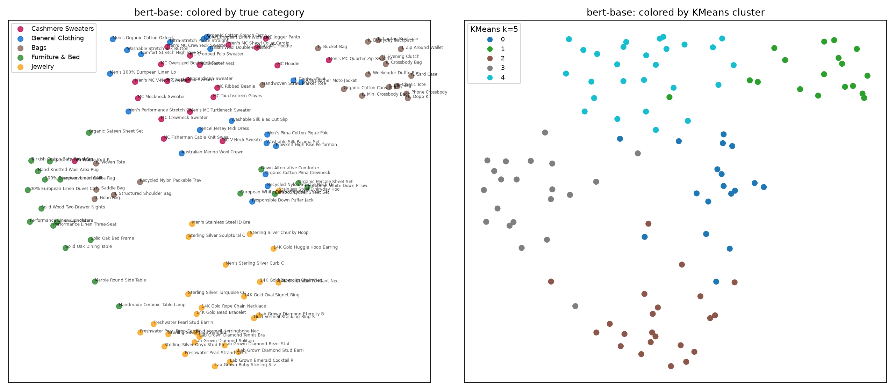
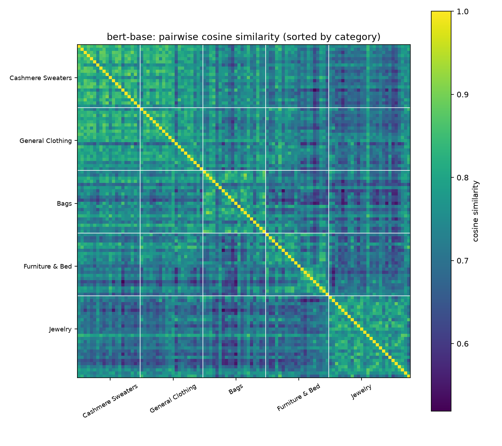
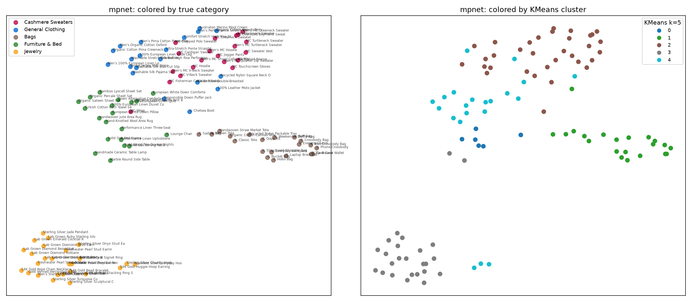
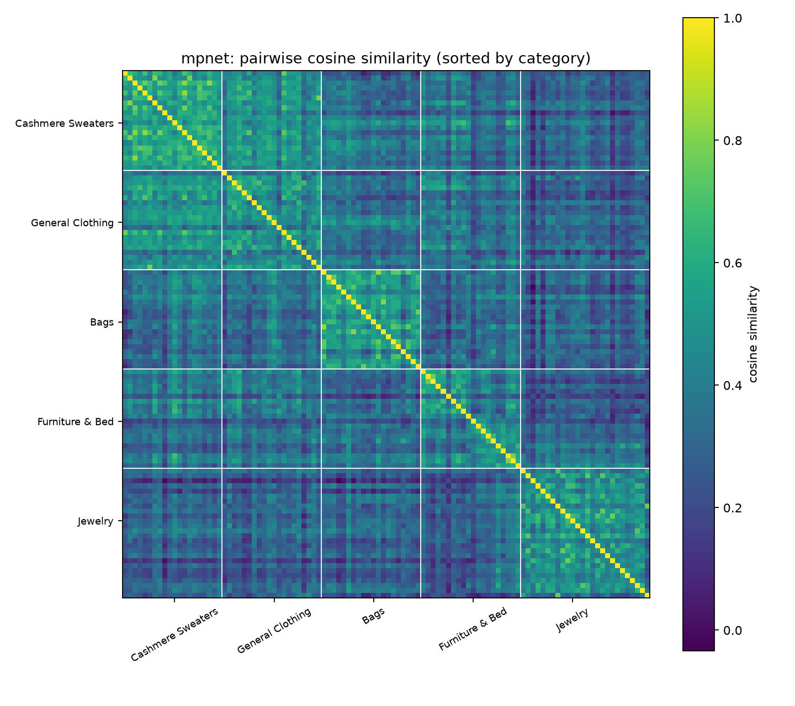

# Quince description embeddings

106 products, 5 categories, embedded text = `description`.

## Model comparison

| model                                   |   dim |   cos_min |   cos_mean |   cos_max |   intra |   inter |   gap |   nn_purity@5 |   kmeans5_ARI |   kmeans5_NMI |   agg5_ARI |   best_k_silhouette |
|:----------------------------------------|------:|----------:|-----------:|----------:|--------:|--------:|------:|--------------:|--------------:|--------------:|-----------:|--------------------:|
| bert-base-uncased                       |   768 |     0.519 |      0.733 |     0.923 |   0.782 |   0.723 | 0.059 |         0.66  |         0.44  |         0.524 |      0.395 |                   2 |
| sentence-transformers/all-mpnet-base-v2 |   768 |    -0.033 |      0.365 |     0.842 |   0.5   |   0.338 | 0.162 |         0.798 |         0.589 |         0.681 |      0.568 |                   5 |

## bert-base (`bert-base-uncased`)

Embedding dim 768. Off-diagonal cosine: min 0.519, mean 0.733, max 0.923.

### Mean cosine similarity between categories

|                   |   cashmere_sweaters |   clothing |   bags |   furniture_bed |   jewelry |
|:------------------|--------------------:|-----------:|-------:|----------------:|----------:|
| cashmere_sweaters |               0.815 |      0.789 |  0.747 |           0.723 |     0.703 |
| clothing          |               0.789 |      0.782 |  0.739 |           0.729 |     0.707 |
| bags              |               0.747 |      0.739 |  0.776 |           0.702 |     0.698 |
| furniture_bed     |               0.723 |      0.729 |  0.702 |           0.759 |     0.696 |
| jewelry           |               0.703 |      0.707 |  0.698 |           0.696 |     0.778 |

Intra-category mean **0.782** vs inter-category mean **0.723** (gap 0.059).
Nearest-neighbor purity@5 (share of top-5 neighbors in the same category): **66.04%**.

Lowest-purity products (their neighbors mostly come from other categories):

| sku     | name                                         | category          |   neighbor_purity |
|:--------|:---------------------------------------------|:------------------|------------------:|
| CSH-011 | Mongolian Cashmere Wrap                      | cashmere_sweaters |               0   |
| CLO-013 | Australian Merino Wool Crewneck Sweater      | clothing          |               0   |
| CLO-019 | Italian Leather Chelsea Boot                 | clothing          |               0   |
| BAG-018 | Handwoven Straw Market Tote                  | bags              |               0   |
| HOM-005 | Down Alternative Comforter                   | furniture_bed     |               0   |
| CSH-015 | Men's Mongolian Cashmere Quarter Zip Sweater | cashmere_sweaters |               0.2 |
| CLO-001 | Organic Cotton Pima Crewneck T-Shirt         | clothing          |               0.2 |
| CLO-006 | Organic Cotton French Terry Sweatshirt       | clothing          |               0.2 |

### Nearest neighbors for a few products

**Mongolian Cashmere Crewneck Sweater** (cashmere_sweaters)
- Men's Mongolian Cashmere V-Neck Sweater (cashmere_sweaters) - 0.893
- Mongolian Cashmere Mockneck Sweater (cashmere_sweaters) - 0.888
- Mongolian Cashmere Cardigan Sweater (cashmere_sweaters) - 0.881
- Tencel Jersey Midi Dress (clothing) - 0.878
- Mongolian Cashmere Fisherman Cable Knit Sweater (cashmere_sweaters) - 0.877

**Washable Stretch Silk Button-Down Shirt** (clothing)
- Comfort Stretch High Rise Straight Jean (clothing) - 0.867
- Ultra-Stretch Ponte Straight Leg Pants (clothing) - 0.852
- Mongolian Cashmere Cardigan Sweater (cashmere_sweaters) - 0.848
- Men's Organic Cotton Oxford Shirt (clothing) - 0.848
- Men's Mongolian Cashmere V-Neck Sweater (cashmere_sweaters) - 0.844

**Italian Leather Classic Tote** (bags)
- Italian Leather Phone Crossbody (bags) - 0.889
- Italian Leather Card Case (bags) - 0.852
- Italian Leather Crossbody Bag (bags) - 0.848
- Italian Leather Belt Bag (bags) - 0.84
- 14K Gold Huggie Hoop Earrings (jewelry) - 0.833

**100% European Linen Duvet Cover Set** (furniture_bed)
- Hand-Knotted Wool Area Rug (furniture_bed) - 0.855
- Turkish Cotton Bath Towel Set (furniture_bed) - 0.846
- Performance Linen Upholstered Platform Bed (furniture_bed) - 0.841
- Men's 100% European Linen Long Sleeve Shirt (clothing) - 0.841
- Solid Wood Two-Drawer Nightstand (furniture_bed) - 0.837

**Lab Grown Diamond Stud Earrings** (jewelry)
- Lab Grown Ruby Sterling Silver Ring (jewelry) - 0.885
- Lab Grown Emerald Cocktail Ring (jewelry) - 0.865
- Lab Grown Diamond Eternity Band (jewelry) - 0.846
- Lab Grown Diamond Bezel Station Necklace (jewelry) - 0.827
- Men's Stainless Steel ID Bracelet (jewelry) - 0.815

**Italian Leather Chelsea Boot** (clothing)
- Recycled Nylon Packable Travel Tote (bags) - 0.821
- Mongolian Cashmere Hoodie (cashmere_sweaters) - 0.818
- Italian Leather Mini Crossbody Bag (bags) - 0.813
- Italian Leather Bucket Bag (bags) - 0.812
- Mongolian Cashmere Crewneck Sweater (cashmere_sweaters) - 0.809

### Most similar cross-category pairs

| a                                              | a_cat             | b                                       | b_cat    |   cosine |
|:-----------------------------------------------|:------------------|:----------------------------------------|:---------|---------:|
| Mongolian Cashmere Sweater Vest                | cashmere_sweaters | 100% European Linen Wide Leg Pants      | clothing |    0.896 |
| Mongolian Cashmere Sweater Vest                | cashmere_sweaters | Organic Cotton French Terry Sweatshirt  | clothing |    0.887 |
| Down Alternative Comforter                     | furniture_bed     | Stainless Steel Everyday Hoop Earrings  | jewelry  |    0.885 |
| Mongolian Cashmere Oversized Boyfriend Sweater | cashmere_sweaters | Organic Cotton French Terry Sweatshirt  | clothing |    0.882 |
| Mongolian Cashmere Jogger Pants                | cashmere_sweaters | 100% European Linen Wide Leg Pants      | clothing |    0.882 |
| Mongolian Cashmere Jogger Pants                | cashmere_sweaters | Organic Cotton French Terry Sweatshirt  | clothing |    0.88  |
| Mongolian Cashmere Crewneck Sweater            | cashmere_sweaters | Tencel Jersey Midi Dress                | clothing |    0.878 |
| Mongolian Cashmere Sweater Vest                | cashmere_sweaters | Ultra-Stretch Ponte Straight Leg Pants  | clothing |    0.877 |
| Men's Mongolian Cashmere Turtleneck Sweater    | cashmere_sweaters | Australian Merino Wool Crewneck Sweater | clothing |    0.875 |
| Mongolian Cashmere V-Neck Sweater              | cashmere_sweaters | Washable Silk Bias Cut Slip Skirt       | clothing |    0.875 |

### Clustering

KMeans k=5 vs true categories: ARI **0.440**, NMI **0.524**. Agglomerative (cosine, average) k=5: ARI 0.395, NMI 0.571.

Category x KMeans cluster:

| category          |   0 |   1 |   2 |   3 |   4 |
|:------------------|----:|----:|----:|----:|----:|
| bags              |   0 |  14 |   0 |   5 |   1 |
| cashmere_sweaters |   2 |   2 |   0 |   1 |  15 |
| clothing          |   6 |   2 |   0 |   1 |  11 |
| furniture_bed     |   5 |   0 |   1 |  14 |   0 |
| jewelry           |   5 |   0 |  21 |   0 |   0 |

Silhouette (cosine) by k: k=2: 0.215, k=3: 0.172, k=4: 0.172, k=5: 0.180, k=6: 0.137, k=7: 0.166, k=8: 0.112, k=9: 0.129, k=10: 0.119, k=11: 0.095, k=12: 0.123

#### Clusters at the best-silhouette k=2

- **Cluster 0** (24): Marble Round Side Table; Handmade Ceramic Table Lamp; 14K Gold Paperclip Chain Necklace; Lab Grown Diamond Stud Earrings; Lab Grown Diamond Tennis Bracelet; Freshwater Pearl Stud Earrings; Freshwater Pearl Strand Necklace; 14K Gold Oval Signet Ring; Sterling Silver Chunky Hoop Earrings; Gold Vermeil Herringbone Necklace; Lab Grown Diamond Solitaire Pendant; Lab Grown Diamond Eternity Band; 14K Gold Initial Pendant Necklace; 14K Gold Bead Bracelet; Freshwater Pearl Drop Earrings; Lab Grown Emerald Cocktail Ring; 14K Gold Rope Chain Necklace; Gold Vermeil Stacking Ring Set; Lab Grown Diamond Bezel Station Necklace; Men's Sterling Silver Curb Chain Necklace; Sterling Silver Jade Pendant Necklace; Lab Grown Ruby Sterling Silver Ring; Sterling Silver Onyx Stud Earrings; Sterling Silver Turquoise Cuff Bracelet
- **Cluster 1** (82): Mongolian Cashmere Crewneck Sweater; Mongolian Cashmere V-Neck Sweater; Mongolian Cashmere Turtleneck Sweater; Mongolian Cashmere Cardigan Sweater; Mongolian Cashmere Oversized Boyfriend Sweater; Mongolian Cashmere Cropped Polo Sweater; Mongolian Cashmere Fisherman Cable Knit Sweater; Mongolian Cashmere Mockneck Sweater; Mongolian Cashmere Sweater Vest; Mongolian Cashmere Hoodie; Mongolian Cashmere Wrap; Mongolian Cashmere Ribbed Beanie; Men's Mongolian Cashmere Crewneck Sweater; Men's Mongolian Cashmere V-Neck Sweater; Men's Mongolian Cashmere Quarter Zip Sweater; Men's Mongolian Cashmere Shawl Collar Cardigan; Men's Mongolian Cashmere Hoodie; Men's Mongolian Cashmere Turtleneck Sweater; Mongolian Cashmere Jogger Pants; Mongolian Cashmere Touchscreen Gloves; Organic Cotton Pima Crewneck T-Shirt; Washable Stretch Silk Button-Down Shirt; 100% European Linen Wide Leg Pants; Men's 100% European Linen Long Sleeve Shirt; Comfort Stretch High Rise Straight Jean; Organic Cotton French Terry Sweatshirt; Washable Silk Bias Cut Slip Skirt; Ultra-Stretch Ponte Straight Leg Pants; Tencel Jersey Midi Dress; Italian Wool Double-Breasted Coat; 100% Leather Moto Jacket; Responsible Down Puffer Jacket; Australian Merino Wool Crewneck Sweater; Men's Performance Stretch Chino Pants; Men's Organic Cotton Oxford Shirt; Washable Silk Pajama Set; Flowknit High Rise Performance Legging; Recycled Nylon Square Neck One-Piece Swimsuit; Italian Leather Chelsea Boot; Men's Pima Cotton Pique Polo; Italian Leather Classic Tote; Italian Leather Crossbody Bag; Italian Leather Mini Crossbody Bag; Italian Leather Bucket Bag; Italian Leather Hobo Bag; Italian Leather Structured Shoulder Bag; Italian Leather Everyday Backpack; Italian Leather Weekender Duffle Bag; Italian Leather Card Case; Italian Leather Zip Around Wallet; Italian Leather Belt Bag; Italian Leather Woven Tote; Italian Leather Laptop Briefcase; Italian Leather Evening Clutch; Recycled Nylon Packable Travel Tote; Organic Cotton Canvas Tote; Italian Leather Saddle Bag; Handwoven Straw Market Tote; Italian Leather Dopp Kit; Italian Leather Phone Crossbody; 100% European Linen Duvet Cover Set; Organic Percale Sheet Set; Bamboo Lyocell Sheet Set; Organic Sateen Sheet Set; Down Alternative Comforter; European White Down Comforter; 100% European Linen Quilt; Turkish Cotton Bath Towel Set; Organic Cotton Waffle Knit Blanket; European White Down Pillow; Solid Oak Bed Frame; Solid Wood Two-Drawer Nightstand; Performance Linen Upholstered Platform Bed; Performance Linen Three-Seat Sofa; Italian Leather Lounge Chair; Solid Oak Dining Table; Handwoven Jute Area Rug; Hand-Knotted Wool Area Rug; 14K Gold Huggie Hoop Earrings; Sterling Silver Sculptural Cuff Bracelet; Men's Stainless Steel ID Bracelet; Stainless Steel Everyday Hoop Earrings

## mpnet (`sentence-transformers/all-mpnet-base-v2`)

Embedding dim 768. Off-diagonal cosine: min -0.033, mean 0.365, max 0.842.

### Mean cosine similarity between categories

|                   |   cashmere_sweaters |   clothing |   bags |   furniture_bed |   jewelry |
|:------------------|--------------------:|-----------:|-------:|----------------:|----------:|
| cashmere_sweaters |               0.579 |      0.488 |  0.352 |           0.361 |     0.29  |
| clothing          |               0.488 |      0.472 |  0.338 |           0.368 |     0.284 |
| bags              |               0.352 |      0.338 |  0.531 |           0.323 |     0.285 |
| furniture_bed     |               0.361 |      0.368 |  0.323 |           0.445 |     0.291 |
| jewelry           |               0.29  |      0.284 |  0.285 |           0.291 |     0.474 |

Intra-category mean **0.500** vs inter-category mean **0.338** (gap 0.162).
Nearest-neighbor purity@5 (share of top-5 neighbors in the same category): **79.81%**.

Lowest-purity products (their neighbors mostly come from other categories):

| sku     | name                                          | category          |   neighbor_purity |
|:--------|:----------------------------------------------|:------------------|------------------:|
| CLO-013 | Australian Merino Wool Crewneck Sweater       | clothing          |               0   |
| CLO-008 | Ultra-Stretch Ponte Straight Leg Pants        | clothing          |               0.2 |
| CLO-010 | Italian Wool Double-Breasted Coat             | clothing          |               0.2 |
| CLO-011 | 100% Leather Moto Jacket                      | clothing          |               0.2 |
| CLO-012 | Responsible Down Puffer Jacket                | clothing          |               0.2 |
| CLO-018 | Recycled Nylon Square Neck One-Piece Swimsuit | clothing          |               0.2 |
| CLO-019 | Italian Leather Chelsea Boot                  | clothing          |               0.2 |
| CSH-011 | Mongolian Cashmere Wrap                       | cashmere_sweaters |               0.4 |

### Nearest neighbors for a few products

**Mongolian Cashmere Crewneck Sweater** (cashmere_sweaters)
- Australian Merino Wool Crewneck Sweater (clothing) - 0.764
- Men's Mongolian Cashmere Crewneck Sweater (cashmere_sweaters) - 0.706
- Mongolian Cashmere Oversized Boyfriend Sweater (cashmere_sweaters) - 0.687
- Mongolian Cashmere V-Neck Sweater (cashmere_sweaters) - 0.684
- Mongolian Cashmere Fisherman Cable Knit Sweater (cashmere_sweaters) - 0.662

**Washable Stretch Silk Button-Down Shirt** (clothing)
- Washable Silk Pajama Set (clothing) - 0.636
- Men's Organic Cotton Oxford Shirt (clothing) - 0.624
- Washable Silk Bias Cut Slip Skirt (clothing) - 0.622
- Men's Mongolian Cashmere Shawl Collar Cardigan (cashmere_sweaters) - 0.618
- Men's 100% European Linen Long Sleeve Shirt (clothing) - 0.604

**Italian Leather Classic Tote** (bags)
- Italian Leather Woven Tote (bags) - 0.842
- Organic Cotton Canvas Tote (bags) - 0.742
- Recycled Nylon Packable Travel Tote (bags) - 0.739
- Handwoven Straw Market Tote (bags) - 0.728
- Italian Leather Everyday Backpack (bags) - 0.67

**100% European Linen Duvet Cover Set** (furniture_bed)
- 100% European Linen Quilt (furniture_bed) - 0.68
- Down Alternative Comforter (furniture_bed) - 0.677
- Men's 100% European Linen Long Sleeve Shirt (clothing) - 0.647
- Washable Silk Pajama Set (clothing) - 0.623
- Mongolian Cashmere Wrap (cashmere_sweaters) - 0.62

**Lab Grown Diamond Stud Earrings** (jewelry)
- Lab Grown Diamond Bezel Station Necklace (jewelry) - 0.651
- Lab Grown Emerald Cocktail Ring (jewelry) - 0.618
- Lab Grown Diamond Solitaire Pendant (jewelry) - 0.578
- Lab Grown Diamond Eternity Band (jewelry) - 0.558
- Freshwater Pearl Stud Earrings (jewelry) - 0.534

**Italian Leather Chelsea Boot** (clothing)
- Italian Wool Double-Breasted Coat (clothing) - 0.597
- Hand-Knotted Wool Area Rug (furniture_bed) - 0.569
- Mongolian Cashmere Cropped Polo Sweater (cashmere_sweaters) - 0.558
- Italian Leather Lounge Chair (furniture_bed) - 0.557
- Mongolian Cashmere Mockneck Sweater (cashmere_sweaters) - 0.557

### Most similar cross-category pairs

| a                                              | a_cat             | b                                           | b_cat         |   cosine |
|:-----------------------------------------------|:------------------|:--------------------------------------------|:--------------|---------:|
| Mongolian Cashmere Cropped Polo Sweater        | cashmere_sweaters | Men's Pima Cotton Pique Polo                | clothing      |    0.788 |
| Mongolian Cashmere Crewneck Sweater            | cashmere_sweaters | Australian Merino Wool Crewneck Sweater     | clothing      |    0.764 |
| Men's Mongolian Cashmere Crewneck Sweater      | cashmere_sweaters | Organic Cotton French Terry Sweatshirt      | clothing      |    0.736 |
| Men's Mongolian Cashmere Crewneck Sweater      | cashmere_sweaters | Australian Merino Wool Crewneck Sweater     | clothing      |    0.735 |
| Mongolian Cashmere Oversized Boyfriend Sweater | cashmere_sweaters | Organic Cotton French Terry Sweatshirt      | clothing      |    0.72  |
| Mongolian Cashmere Mockneck Sweater            | cashmere_sweaters | Australian Merino Wool Crewneck Sweater     | clothing      |    0.718 |
| Mongolian Cashmere Cardigan Sweater            | cashmere_sweaters | Men's 100% European Linen Long Sleeve Shirt | clothing      |    0.697 |
| Mongolian Cashmere Oversized Boyfriend Sweater | cashmere_sweaters | Australian Merino Wool Crewneck Sweater     | clothing      |    0.692 |
| Mongolian Cashmere Wrap                        | cashmere_sweaters | Handwoven Jute Area Rug                     | furniture_bed |    0.686 |
| Men's Mongolian Cashmere Turtleneck Sweater    | cashmere_sweaters | Australian Merino Wool Crewneck Sweater     | clothing      |    0.682 |

### Clustering

KMeans k=5 vs true categories: ARI **0.589**, NMI **0.681**. Agglomerative (cosine, average) k=5: ARI 0.568, NMI 0.765.

Category x KMeans cluster:

| category          |   0 |   1 |   2 |   3 |   4 |
|:------------------|----:|----:|----:|----:|----:|
| bags              |   0 |  20 |   0 |   0 |   0 |
| cashmere_sweaters |   0 |   0 |  18 |   0 |   2 |
| clothing          |   0 |   1 |  15 |   0 |   4 |
| furniture_bed     |   6 |   0 |   0 |   2 |  12 |
| jewelry           |   0 |   0 |   0 |  23 |   3 |

Silhouette (cosine) by k: k=2: 0.190, k=3: 0.197, k=4: 0.194, k=5: 0.199, k=6: 0.170, k=7: 0.148, k=8: 0.136, k=9: 0.117, k=10: 0.102, k=11: 0.108, k=12: 0.100

#### Clusters at the best-silhouette k=5

- **Cluster 0** (6): Solid Oak Bed Frame; Solid Wood Two-Drawer Nightstand; Performance Linen Upholstered Platform Bed; Performance Linen Three-Seat Sofa; Italian Leather Lounge Chair; Solid Oak Dining Table
- **Cluster 1** (21): 100% Leather Moto Jacket; Italian Leather Classic Tote; Italian Leather Crossbody Bag; Italian Leather Mini Crossbody Bag; Italian Leather Bucket Bag; Italian Leather Hobo Bag; Italian Leather Structured Shoulder Bag; Italian Leather Everyday Backpack; Italian Leather Weekender Duffle Bag; Italian Leather Card Case; Italian Leather Zip Around Wallet; Italian Leather Belt Bag; Italian Leather Woven Tote; Italian Leather Laptop Briefcase; Italian Leather Evening Clutch; Recycled Nylon Packable Travel Tote; Organic Cotton Canvas Tote; Italian Leather Saddle Bag; Handwoven Straw Market Tote; Italian Leather Dopp Kit; Italian Leather Phone Crossbody
- **Cluster 2** (33): Mongolian Cashmere Crewneck Sweater; Mongolian Cashmere V-Neck Sweater; Mongolian Cashmere Turtleneck Sweater; Mongolian Cashmere Cardigan Sweater; Mongolian Cashmere Oversized Boyfriend Sweater; Mongolian Cashmere Cropped Polo Sweater; Mongolian Cashmere Mockneck Sweater; Mongolian Cashmere Sweater Vest; Mongolian Cashmere Hoodie; Mongolian Cashmere Ribbed Beanie; Men's Mongolian Cashmere Crewneck Sweater; Men's Mongolian Cashmere V-Neck Sweater; Men's Mongolian Cashmere Quarter Zip Sweater; Men's Mongolian Cashmere Shawl Collar Cardigan; Men's Mongolian Cashmere Hoodie; Men's Mongolian Cashmere Turtleneck Sweater; Mongolian Cashmere Jogger Pants; Mongolian Cashmere Touchscreen Gloves; Washable Stretch Silk Button-Down Shirt; 100% European Linen Wide Leg Pants; Men's 100% European Linen Long Sleeve Shirt; Comfort Stretch High Rise Straight Jean; Organic Cotton French Terry Sweatshirt; Washable Silk Bias Cut Slip Skirt; Ultra-Stretch Ponte Straight Leg Pants; Tencel Jersey Midi Dress; Italian Wool Double-Breasted Coat; Australian Merino Wool Crewneck Sweater; Men's Performance Stretch Chino Pants; Men's Organic Cotton Oxford Shirt; Washable Silk Pajama Set; Italian Leather Chelsea Boot; Men's Pima Cotton Pique Polo
- **Cluster 3** (25): Marble Round Side Table; Handmade Ceramic Table Lamp; 14K Gold Paperclip Chain Necklace; Lab Grown Diamond Stud Earrings; Lab Grown Diamond Tennis Bracelet; Freshwater Pearl Stud Earrings; Freshwater Pearl Strand Necklace; 14K Gold Oval Signet Ring; Gold Vermeil Herringbone Necklace; Lab Grown Diamond Solitaire Pendant; Lab Grown Diamond Eternity Band; 14K Gold Initial Pendant Necklace; Sterling Silver Sculptural Cuff Bracelet; 14K Gold Bead Bracelet; Freshwater Pearl Drop Earrings; Lab Grown Emerald Cocktail Ring; 14K Gold Rope Chain Necklace; Gold Vermeil Stacking Ring Set; Lab Grown Diamond Bezel Station Necklace; Men's Sterling Silver Curb Chain Necklace; Sterling Silver Jade Pendant Necklace; Lab Grown Ruby Sterling Silver Ring; Sterling Silver Onyx Stud Earrings; Sterling Silver Turquoise Cuff Bracelet; Men's Stainless Steel ID Bracelet
- **Cluster 4** (21): Mongolian Cashmere Fisherman Cable Knit Sweater; Mongolian Cashmere Wrap; Organic Cotton Pima Crewneck T-Shirt; Responsible Down Puffer Jacket; Flowknit High Rise Performance Legging; Recycled Nylon Square Neck One-Piece Swimsuit; 100% European Linen Duvet Cover Set; Organic Percale Sheet Set; Bamboo Lyocell Sheet Set; Organic Sateen Sheet Set; Down Alternative Comforter; European White Down Comforter; 100% European Linen Quilt; Turkish Cotton Bath Towel Set; Organic Cotton Waffle Knit Blanket; European White Down Pillow; Handwoven Jute Area Rug; Hand-Knotted Wool Area Rug; 14K Gold Huggie Hoop Earrings; Sterling Silver Chunky Hoop Earrings; Stainless Steel Everyday Hoop Earrings

<!-- set-model:start -->
## Masked set model: learning the taxonomy into the space

Each product list ("menu") is a header plus every product it lists, e.g. `Jewelry · Rings · Gold`. All tokens are frozen MPNet vectors passed through a small shared adapter; role embeddings stand in for positions, so list order does not matter. Two equally weighted objectives: hide a product and predict it, and hide a header slot and name it from the listed products. Full softmax (InfoNCE), each correct answer weighted equally.

Every product is trained on. 39 multi-slot menus are held out entirely; each of their header values was learned on other menus, so filling them in tests whether learned concepts compose.

### Filling in held-out menus from the header alone

| | mAP | R@10 | P@5 |
|---|---:|---:|---:|
| MPNet (raw) | 0.494 | 0.587 | 0.415 |
| Skip-gram tokens | 0.614 | 0.778 | 0.513 |
| Adapter only (item only) | 0.624 | 0.730 | 0.559 |
| Adapter only (item + header) | 0.836 | 0.855 | 0.697 |
| Set transformer, item only | 0.896 | 0.884 | 0.744 |
| Set transformer, item + header | 0.891 | 0.888 | 0.728 |
| Deep Sets, item + header | 0.800 | 0.802 | 0.626 |

### Naming a list (3 products, no header)

Top answer must be a value all 3 products share.

| | all slots | department | type | material | price |
|---|---:|---:|---:|---:|---:|
| MPNet (raw) | 0.618 | 0.808 | 0.615 | 0.812 | 0.500 |
| Skip-gram tokens | 0.831 | 1.000 | 1.000 | 1.000 | 0.500 |
| Adapter only (item only) | 0.775 | 1.000 | 0.846 | 0.688 | 0.667 |
| Adapter only (item + header) | 0.921 | 1.000 | 1.000 | 1.000 | 0.667 |
| Set transformer, item + header | 0.978 | 1.000 | 1.000 | 1.000 | 0.667 |
| Deep Sets, item + header | 0.955 | 1.000 | 1.000 | 1.000 | 0.500 |

### The product space itself (5-NN label agreement, in-sample)

| | department | type | occasion | price |
|---|---:|---:|---:|---:|
| MPNet (raw) | 0.798 | 0.432 | 0.530 | 0.445 |
| Skip-gram item vectors | 0.989 | 0.504 | 0.792 | 0.721 |
| Adapter (item only) | 0.962 | 0.600 | 0.802 | 0.715 |
| Adapter (item + header) | 0.970 | 0.632 | 0.766 | 0.702 |
| Adapter (Deep Sets, item + header) | 0.964 | 0.615 | 0.781 | 0.715 |

Price is not in the product text, so any price structure in a space came from the menus.

Taxonomy: `quince_taxonomy.py`. Model and evaluation: `quince_set_model.py`. Full tables and free-text query examples: [set_model_report.md](set_model_report.md).
<!-- set-model:end -->
